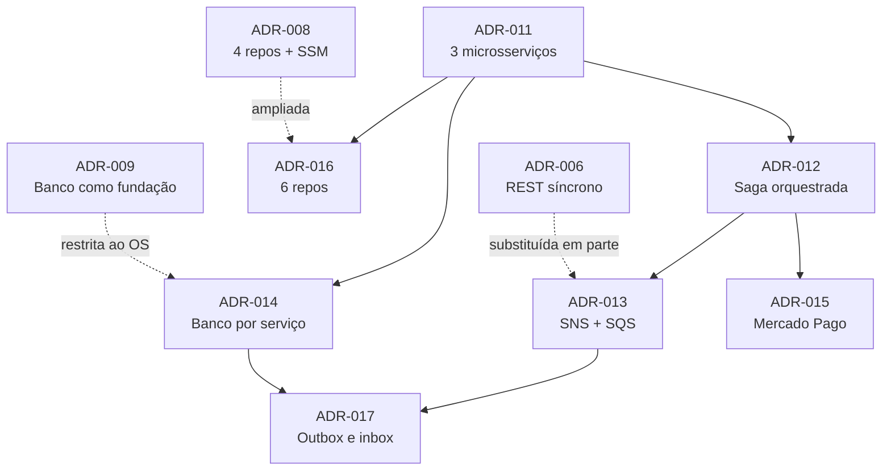

# ADRs da Fase 4

Continuam a numeração de [`../../fase-3/adr/`](../../fase-3/adr/README.md), com o mesmo
formato: `Status` · `Contexto` · `Decisão` · `Consequências` · `Alternativas consideradas`.

| ADR | Título | Status | Relação com as anteriores |
|---|---|---|---|
| [011](011-divisao-em-tres-microsservicos.md) | Divisão em três microsserviços | Aceita | — |
| [012](012-saga-orquestrada-no-servico-de-os.md) | Saga orquestrada, com o orquestrador no serviço de OS | Aceita | revê a alternativa "saga" descartada na ADR-004 |
| [013](013-mensageria-com-sns-e-sqs.md) | Mensageria com SNS e SQS | Aceita | substitui em parte a ADR-006 |
| [014](014-um-banco-por-servico.md) | Um banco por serviço: dois MySQL e um DynamoDB | Aceita | restringe a ADR-009 ao serviço de OS |
| [015](015-pagamento-com-mercado-pago.md) | Pagamento com Mercado Pago, antes do reparo | Aceita | — |
| [016](016-seis-repositorios-infra-junto-do-servico.md) | Seis repositórios, com a infraestrutura de cada serviço no próprio repo | Aceita | amplia a ADR-008 |
| [017](017-outbox-inbox-e-idempotencia.md) | Outbox, inbox e consumidores idempotentes | Aceita | complementa a ADR-004 |

