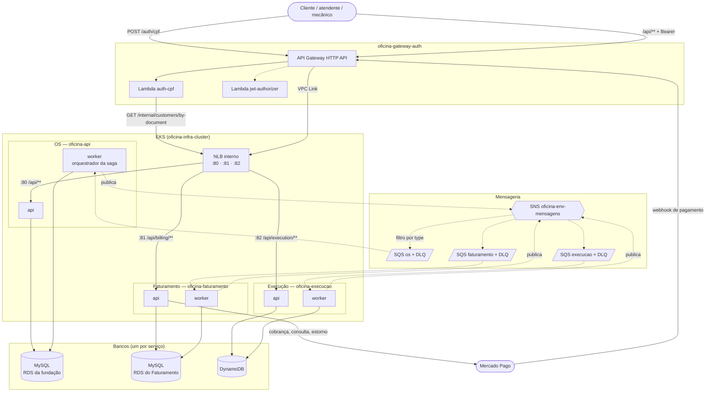

# Arquitetura da Fase 4

Os três microsserviços, os bancos e os dois estilos de comunicação: REST do cliente para cada
serviço (linhas cheias) e mensagens entre os serviços (linhas tracejadas). Os nomes e as portas
são os do [`CONTRATOS.md`](../CONTRATOS.md).

O que o diagrama garante:

- cada serviço fala só com o próprio banco;
- os serviços não se chamam por HTTP: a única chamada interna síncrona é a da `auth-cpf` ao OS;
- todo serviço publica no mesmo tópico e lê só da própria fila;
- a API de cada serviço grava a mensagem na outbox do próprio banco; quem publica é o worker.
