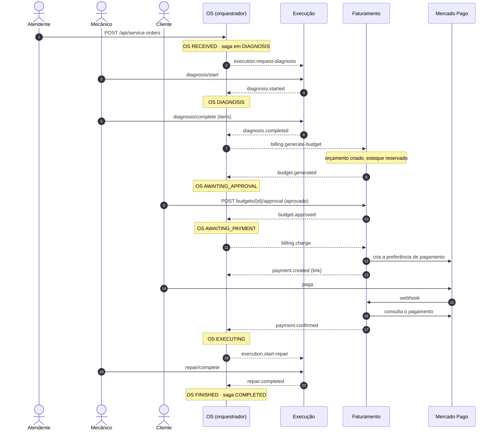
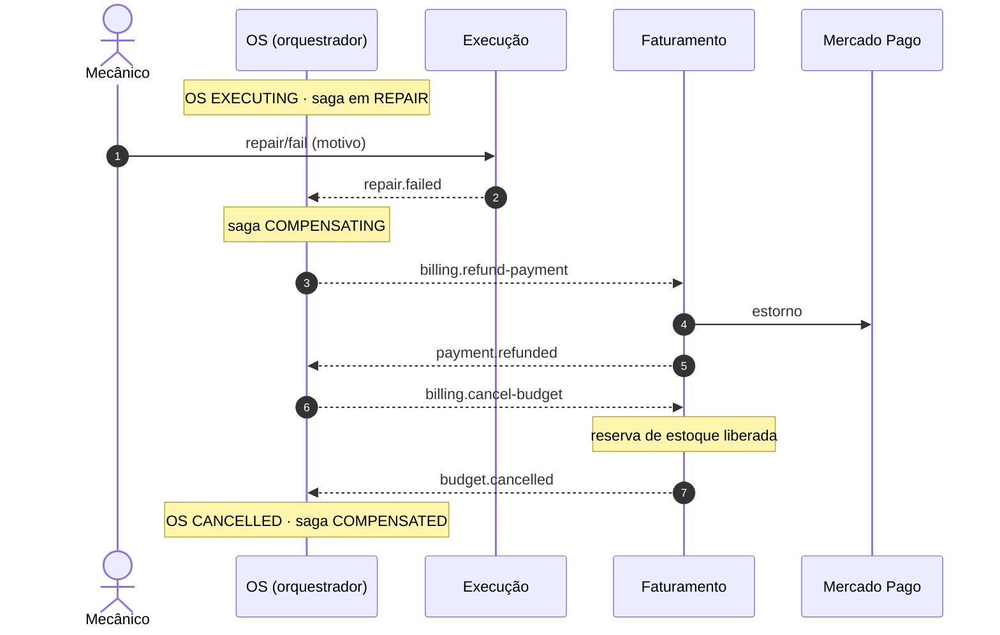
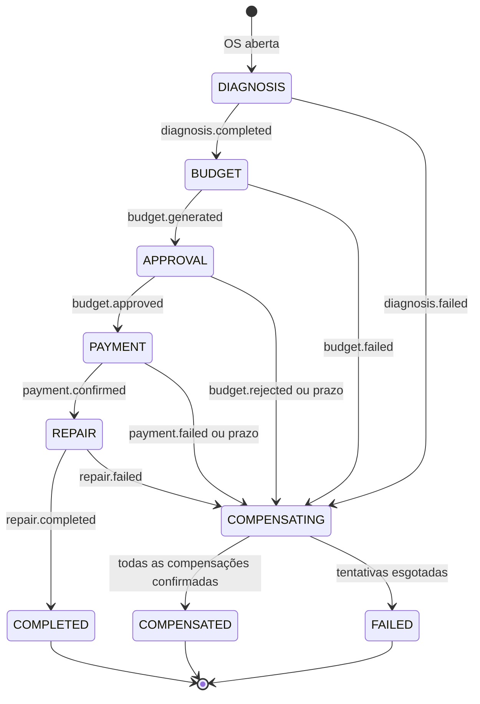
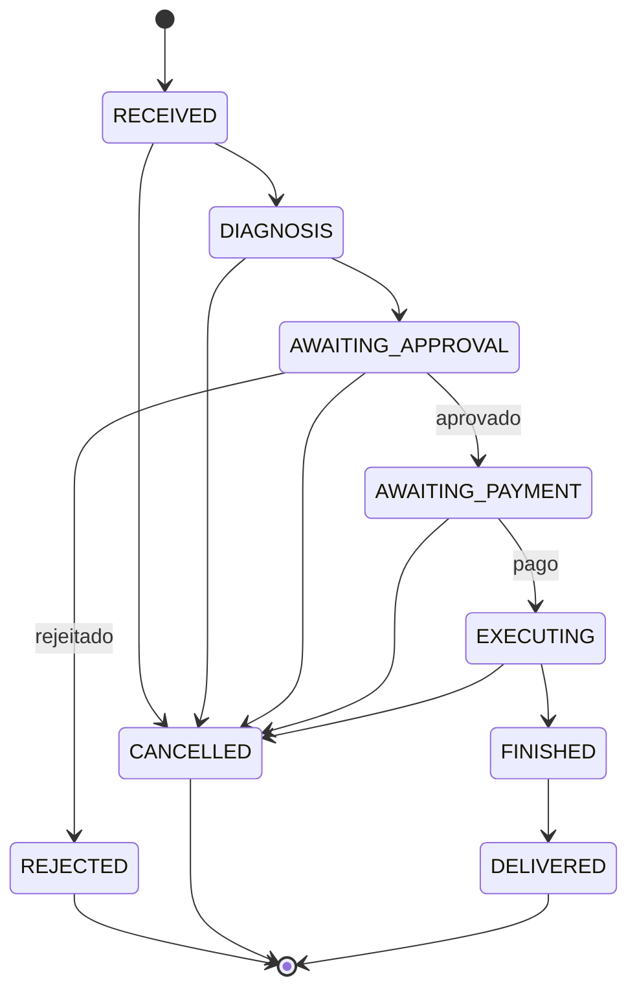

# Saga da ordem de serviço

Os passos, as mensagens e as compensações são os do [`CONTRATOS.md`](../CONTRATOS.md), §5 e §6.
A decisão por orquestração está na [ADR-012](../adr/012-saga-orquestrada-no-servico-de-os.md).

## Caminho feliz

Setas cheias são HTTP; setas tracejadas são mensagens pelo tópico.

## Compensação: o reparo falha depois do pagamento

## Todas as falhas

| A saga falha em | O que já tinha sido feito | O que a compensação desfaz |
|---|---|---|
| `DIAGNOSIS` | tarefa criada na Execução (encerrada por ela mesma) | nada |
| `BUDGET` | tarefa na Execução | cancela a tarefa |
| `APPROVAL` (rejeitado) | tarefa, orçamento (o Faturamento libera o estoque ao rejeitar) | cancela a tarefa |
| `APPROVAL` (prazo) | tarefa, orçamento com estoque reservado | cancela o orçamento e a tarefa |
| `PAYMENT` | tarefa, orçamento com estoque reservado, cobrança criada | cancela o orçamento e a tarefa |
| `REPAIR` | tudo, inclusive o pagamento | estorna o pagamento e cancela o orçamento |

## Status da OS

`AWAITING_PAYMENT` e `CANCELLED` são novos na Fase 4.
